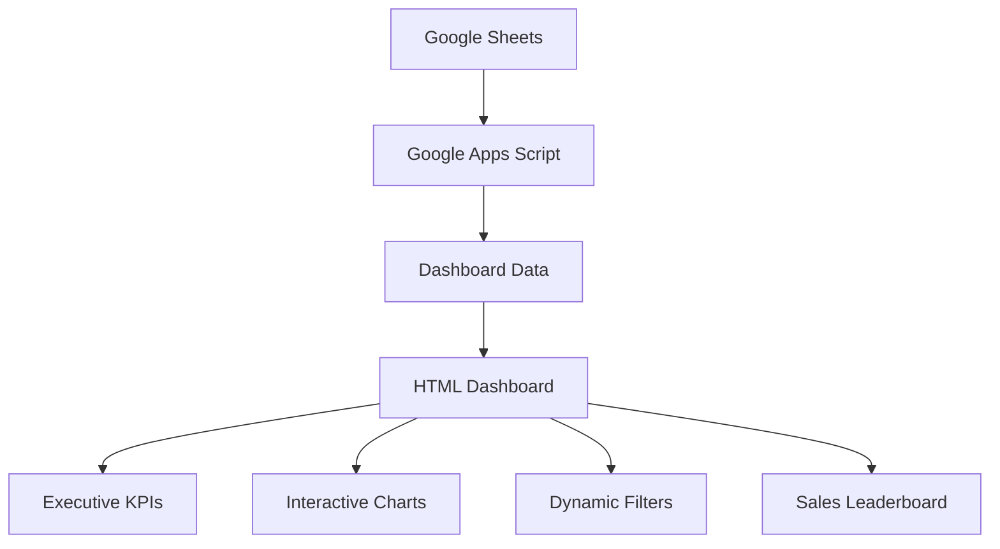

# 📊 Sales Dashboard — Excel & Google Apps Script

A real-time sales analytics dashboard built with HTML and Google Apps Script, connected to Google Sheets to transform spreadsheet data into actionable business insights.

Get a clear overview of sales performance through executive KPIs, interactive charts, dynamic filters, and a sales leaderboard — all in one web-based dashboard.

## 🚀 Live Demo

**[View Live Dashboard](https://iarchonn.github.io/Excel-Dashboard-Apps-Script/)**

- **Repository:** [Excel-Dashboard-Apps-Script](https://github.com/iarchonn/Excel-Dashboard-Apps-Script)
- **Data Source:** [Google Sheets](https://docs.google.com/spreadsheets/d/1X-pM2X1WR6D6YRYat8r3aj_qcEgQjtEOxeKYZpwu_E4/edit?gid=0#gid=0)

## ✨ Features

### 📈 Executive KPI Overview
- Key performance indicators for monitoring sales performance.
- Quick overview of important business metrics.
- Centralized view for faster performance evaluation.

### 📊 Interactive Data Visualization
- Grouped bar charts for comparing sales metrics.
- Doughnut charts for understanding category distribution.
- Visual summaries that make sales data easier to interpret.

### 🔎 Dynamic Filters
- Filter sales data to explore specific segments.
- Analyze business performance from different perspectives.
- Support more focused and efficient data exploration.

### 🏆 Sales Leaderboard
- Rank sales performance to identify top performers.
- Compare results across sales representatives or available categories.
- Make performance evaluation easier through a visual ranking.

### 🔄 Google Sheets Integration
- Connect dashboard data with a Google Sheets spreadsheet.
- Reflect spreadsheet data in the dashboard through the configured synchronization workflow.
- Reduce the need to prepare separate reports manually.

### 🌐 Web-Based Dashboard
- Access sales insights through a browser.
- Built with HTML and Google Apps Script.
- Hosted using GitHub Pages for easy access to the frontend.

## 🛠️ Tech Stack

| Technology | Purpose |
|---|---|
| HTML5 | Dashboard structure |
| CSS3 | Layout and visual styling |
| JavaScript | Interactive dashboard behavior |
| Google Apps Script | Spreadsheet integration and application logic |
| Google Sheets | Sales data source |
| GitHub Pages | Frontend hosting |

## 🏗️ How It Works

The dashboard connects spreadsheet-based sales data to a web interface for interactive reporting.



1. **Data source:** Sales records are maintained in Google Sheets.
2. **Data processing:** Google Apps Script handles the spreadsheet integration and dashboard logic.
3. **Data presentation:** The HTML interface presents the information through KPI cards, charts, filters, and leaderboard components.
4. **Data exploration:** Users interact with the dashboard to examine sales performance and compare results.

## 📂 Project Structure

```text
Excel-Dashboard-Apps-Script/
├── index.html
└── README.md
```

- `index.html` — Contains the dashboard interface and frontend implementation.
- `README.md` — Project documentation.

## ⚙️ Getting Started

### Option 1: View the Live Dashboard

Open the [live dashboard](https://iarchonn.github.io/Excel-Dashboard-Apps-Script/) in your browser.

### Option 2: Run Locally

Clone the repository:

```bash
git clone https://github.com/iarchonn/Excel-Dashboard-Apps-Script.git
```

Navigate to the project directory:

```bash
cd Excel-Dashboard-Apps-Script
```

Open `index.html` in your browser or use the Live Server extension in Visual Studio Code.

**Note:** Running the frontend locally does not automatically configure the Google Apps Script connection. A working data connection and the appropriate permissions are required to display live spreadsheet data.

## 🔌 Google Sheets Configuration

To connect the dashboard to your own sales data:

1. Prepare a Google Sheets spreadsheet containing your sales records.
2. Configure the Google Apps Script integration according to the project's implementation.
3. Ensure the script has the required spreadsheet permissions.
4. Configure or deploy the script endpoint if required by the frontend.
5. Verify that the dashboard can retrieve and display the expected data.

The exact spreadsheet structure and deployment settings should match the existing script implementation.

## 🎯 Project Goals

This project explores how spreadsheet data can be transformed into a more accessible and interactive sales reporting experience.

Its main goals are to:

- Simplify sales performance monitoring.
- Present business metrics in a visual format.
- Support data-driven decision-making.
- Reduce reliance on manually prepared reports.
- Demonstrate practical integration between frontend development and Google Workspace tools.

## 🔮 Potential Improvements

Possible future enhancements include:

- Additional sales trend and revenue analysis charts.
- Date-range filtering and more advanced segmentation.
- Exportable reports in CSV or PDF format.
- Improved error handling and loading indicators.
- More detailed sales performance comparisons.
- Enhanced access control for sensitive business data.

## 📌 Project Status

**Status: Prototype**

This project is a portfolio demonstration of a web-based sales dashboard using HTML, JavaScript, Google Apps Script, and Google Sheets.

## 👨‍💻 Author

**iarchonn**

- GitHub: [@iarchonn](https://github.com/iarchonn)

---

If you find this project useful, feel free to explore the repository and try the live dashboard.
